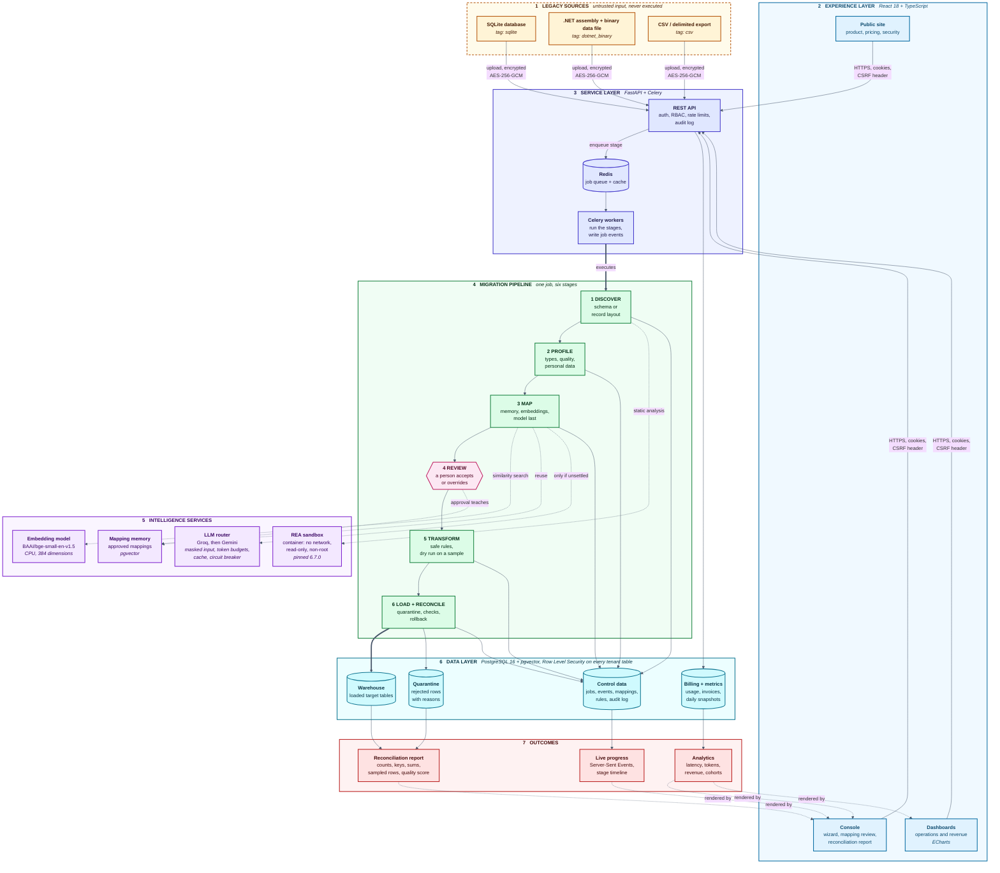

# LegacyLift

**Legacy data discovery, mapping, migration and reconciliation, with evidence at every step.**


---

## Table of contents

1. [Overview](#overview)
2. [Objectives](#objectives)
3. [What we build](#what-we-build)
4. [How it helps](#how-it-helps)
5. [Architecture](#architecture)
6. [The migration pipeline](#the-migration-pipeline)
7. [Features](#features)
8. [Technology stack](#technology-stack)
9. [Repository structure](#repository-structure)
10. [Getting started](#getting-started)
11. [Demo accounts](#demo-accounts)
12. [Using the console](#using-the-console)
13. [Datasets](#datasets)
14. [Evaluation results](#evaluation-results)
15. [Token efficiency](#token-efficiency)
16. [Security and tenant isolation](#security-and-tenant-isolation)
17. [Dashboards](#dashboards)
18. [Testing](#testing)
19. [API reference](#api-reference)
20. [Limitations](#limitations)
21. [Roadmap](#roadmap)
22. [Troubleshooting](#troubleshooting)
23. [Attributions and licenses](#attributions-and-licenses)

---

## Overview

LegacyLift is a platform that moves data out of legacy systems whose structure nobody has documented. Given a database file, or a compiled desktop application together with its proprietary data file, it works out how the data is stored, finds the quality problems in it, proposes a mapping to a modern target schema, lets a person review that mapping, rehearses the transformation on a sample, loads the result, and proves with a reconciliation report that nothing was lost or changed without a record.

The platform is multi-tenant. Each organization sees only its own sources, jobs, mappings and reports; the separation is enforced by the database, not by application filters.

> The two sample legacy systems, the revenue history behind the revenue dashboard, and all figures in this document come from synthetic or open data. No real personal data is used anywhere in the repository.

## Objectives

| # | Objective | How it is met |
|---|---|---|
| 1 | Recover the structure of a legacy system without documentation | Static analysis of the database or of the compiled program, validated against the data file; every result keeps the evidence that produced it |
| 2 | Keep the use of language models small, bounded and safe | Rules and embeddings settle most columns first; a model sees only what they could not settle, only as masked statistics, within a token budget per job and per day |
| 3 | Make a migration trustworthy | A dry run before the load, quarantine of every row that cannot be loaded (with its reason), reconciliation checks that must all pass, rollback by job |
| 4 | Keep each customer's data apart | PostgreSQL Row Level Security, role based access, an append-only audit log |
| 5 | Show what happened and what it cost | A console with live progress, an analytics dashboard for operations, a revenue dashboard for administrators |
| 6 | Prove it with measurements | An evaluation harness scores the platform against known answers and writes the results to [docs/evaluation.md](docs/evaluation.md) |

## What we build

LegacyLift consists of five parts.

- **An API** (FastAPI, Python 3.12) that owns authentication, roles, jobs, mappings, rules, billing and analytics.
- **A pipeline** of six stages (discover, profile, map, review, transform, load and reconcile) that runs in background workers and reports its progress as a stream of events.
- **A console** (React, TypeScript) with a seven step migration wizard, mapping review, reconciliation reports, team and audit pages, an operations dashboard and a revenue dashboard.
- **A public site** that explains the product, its pricing and its security.
- **An evaluation and hardening toolkit**: a harness that scores the pipeline against known answers, a load check, a coverage gate, a secret scan and a security review.

The platform supports three kinds of input:

| Input | How its structure is found | Static analysis tool used |
|---|---|---|
| SQLite database | Tables, columns with declared types, indexes, views, triggers and sample rows | Yes (SQLite inspection) |
| .NET desktop assembly and its binary data file | The record layout is recovered from the program's metadata and instructions, then validated against the data file; the data file alone gives a lower-confidence statistical layout | Yes (managed code analysis) |
| CSV or other delimited file | Profiled directly, there is no structure to discover | No |

The static analysis tool is [REA](https://github.com/morluto/rea) (MIT), pinned to one version and run only inside an isolated container. An uploaded file is only ever read as data; it is never executed.

## How it helps

| Problem | What LegacyLift does about it |
|---|---|
| The system has no schema documentation and cryptic names (`CUST_MST`, `f_nm`) | Recovers the structure, and suggests which target field each column belongs to, with a confidence and the method that produced it |
| The data file is a proprietary binary format | Recovers the record layout from the program that wrote it, and checks the layout against the file |
| Quality problems are discovered after the migration | Profiles the source first: duplicates, missing required values, invalid dates, out-of-range numbers, orphan references, personal data |
| Mapping by hand is slow and is forgotten after the project | Every approved mapping is remembered and reused for similar columns in later migrations |
| Language models are costly and may leak data | They are the last resort, see only masked column statistics, and are limited by budgets |
| It is hard to know whether a migration lost anything | Every source row is either loaded or quarantined with a reason; totals, keys, sums and a sample of rows are checked, and a failed check rolls the load back |
| Nobody can see where time and money go | Live stage timeline per migration, latency percentiles per stage, token use per provider, usage and invoices per organization |

## Architecture

The diagram shows the whole path of a migration, from the legacy source to the reconciled data and the dashboards, and the services that support each stage.



**Reading the diagram.** Solid arrows carry data or commands, thick arrows are the main path of a job, dotted arrows are calls to supporting services. Layers 5 and 6 are shared by every stage: the intelligence services answer questions, the data layer stores every result, and PostgreSQL applies the tenant filter itself.

### Job lifecycle

A job moves through a fixed set of states. Each change is written as an event, which is what the console follows live.

```mermaid
%%{init: {"theme": "base", "themeVariables": {"fontFamily": "Inter, Segoe UI, Arial, sans-serif", "primaryColor": "#E0E7FF", "primaryBorderColor": "#4338CA", "primaryTextColor": "#1E1B4B", "lineColor": "#475569"}}}%%
stateDiagram-v2
    direction LR
    [*] --> CREATED
    CREATED --> UPLOADED
    UPLOADED --> DISCOVERING
    DISCOVERING --> PROFILED
    PROFILED --> MAPPED
    MAPPED --> AWAITING_REVIEW: rules generated
    AWAITING_REVIEW --> DRY_RUN: person approves
    DRY_RUN --> AWAITING_REVIEW: a rule blocks the load
    DRY_RUN --> READY: nothing blocks
    READY --> LOADING
    LOADING --> RECONCILING
    RECONCILING --> COMPLETED: every check passed
    COMPLETED --> ROLLED_BACK: rollback by job
    DISCOVERING --> FAILED
    LOADING --> FAILED: a check failed, load undone
    COMPLETED --> [*]
    FAILED --> [*]
    ROLLED_BACK --> [*]
```



## The migration pipeline

| Stage | What it does | Main components |
|---|---|---|
| **1. Discover** | Produces a source schema, or a record layout with a confidence per field and the evidence behind it | REA in its sandbox; deterministic extractors; validation of the layout against the data file |
| **2. Profile** | Types, null rates, patterns, cardinality, personal data flags, quality issues, a quality score | pandas in chunks; a personal data detector that keeps no values for flagged columns |
| **3. Map** | Ranks target fields for every source column and decides what is settled | Mapping memory first, then embedding similarity with thresholds, then the language model for what is still unclear |
| **4. Review** | A person accepts, overrides (with a searchable picker) or rejects; high-confidence suggestions can be approved together; every approval is remembered | Console |
| **5. Transform** | Turns mappings into rules (a small, safe set of operations, never code), previews them before and after on real values, and rehearses the whole set on a sample with a cost estimate | Rule engine; dry run |
| **6. Load and reconcile** | Stages the rows, quarantines every row that fails with a reason, loads the rest, then checks row accounting, distinct keys, null counts, numeric sums and a sample of rows; any failed check rolls the load back | PostgreSQL warehouse; reconciliation |

## Features

**Discovery and mapping**
- SQLite schema discovery; .NET record layout recovery with per-field confidence; evidence for every field
- Embedding-based mapping with tunable thresholds; mapping memory that grows with every approval
- A model router with provider failover, a response cache, token budgets and a circuit breaker

**Migration**
- Seven step wizard with live progress over Server-Sent Events
- Rule preview (before and after), code table editor for fields stored as numeric codes
- Dry run with an estimate of rows, time and tokens
- Quarantine with reasons, CSV export, reconciliation report, rollback

**Operations and business**
- Operations dashboard: jobs, success rate, throughput, mapping automation, stage latency, token use, quality, error taxonomy, discovery confidence
- Revenue dashboard (administrators): MRR, movement and waterfall, plans, industries, regions, cohorts, unit economics, top customers, invoices, with a labelled projection
- Billing: plans, usage meter, invoices, printable invoice view
- Team, audit log, settings (provider order, budgets, data retention)

**Platform**
- Roles: administrator, analyst, viewer; organization switcher for people in several organizations
- Command palette, notifications, light and dark themes, keyboard operable and checked against WCAG 2.1 AA

## Technology stack

| Layer | Technology |
|---|---|
| API | Python 3.12, FastAPI, Pydantic v2, Uvicorn |
| Data access | SQLAlchemy 2, Alembic, psycopg 3 |
| Database | PostgreSQL 16 with pgvector, Row Level Security |
| Jobs | Celery, Redis, Server-Sent Events |
| Data processing | pandas, pandera |
| Embeddings | `BAAI/bge-small-en-v1.5` through sentence-transformers (CPU) |
| Language models | Groq `openai/gpt-oss-20b`, Google Gemini Flash-Lite class model (both optional) |
| Reverse engineering | REA (`rea-agents` 6.7.0) on Node.js 24, in a locked-down container |
| Security | argon2id, PyJWT, AES-256-GCM, slowapi, strict Content-Security-Policy |
| Frontend | React 18, TypeScript (strict), Vite, Tailwind CSS, Radix UI, TanStack Query and Table, React Hook Form, Zod, Apache ECharts |
| Tests | pytest, Vitest, Testing Library, Playwright with axe |
| Operations | Docker Compose, GitHub Actions, Trivy, pip-audit, npm audit |

## Repository structure

```
.
├── backend/                 FastAPI application
│   ├── app/
│   │   ├── api/             routes, errors, dependencies
│   │   ├── core/            settings, security, crypto, middleware
│   │   ├── db/              models, repositories, sessions
│   │   ├── discovery/       schema and layout discovery, REA adapter
│   │   ├── profiling/       profiling, personal data, quality
│   │   ├── mapping/         embeddings, decisions, thresholds, memory
│   │   ├── llm/             router, providers, budgets, cache
│   │   ├── transform/       rules, dry run, load, reconciliation
│   │   ├── jobs/            stages and workers
│   │   ├── billing/         plans, metering, invoices, analytics
│   │   └── evaluation/      scoring against ground truth
│   ├── alembic/             migrations
│   └── tests/
├── frontend/                site and console
│   ├── src/console/         shell, pages, wizard, charts
│   ├── src/site/            public pages
│   └── e2e/                 Playwright tests
├── rea-runner/              sandboxed wrapper around the pinned REA tool
├── datasets/                sample legacy systems, ground truth, target schemas
├── scripts/                 evaluation, load check, coverage gate, secret scan
├── docs/                    architecture, security, evaluation
└── docker-compose.yml
```

## Getting started

### Prerequisites

| Tool | Version |
|---|---|
| Docker (with Compose) | current |
| Python | 3.12, with [uv](https://docs.astral.sh/uv/) |
| Node.js | 24.15 or newer |
| Disk | about 3 GB (the embedding model and its dependencies) |

### 1. Configure

```
cp .env.example .env
```

The defaults work for local use. Outside local use set `ENVIRONMENT`, `JWT_SECRET` and `UPLOAD_ENCRYPTION_KEY` (the application refuses to start on the development values); generation commands are in `.env.example`.

Language model keys are optional. Without them the platform maps by rules and embeddings only, and columns that need a model wait for review.

| Provider | Where to get a key | Variable |
|---|---|---|
| Groq | the API keys page of the Groq console | `GROQ_API_KEY` |
| Google Gemini | Google AI Studio | `GEMINI_API_KEY` |

Free tier providers may use prompts to improve their products. The platform sends only masked column statistics, never rows.

### 2. Start the database and the queue

```
docker compose up -d db redis
```

PostgreSQL listens on port 5544 and Redis on 6380, so they do not collide with local installations.

### 3. Install and prepare the back end

```
cd rea-runner && npm ci --ignore-scripts && cd ..
cd backend
uv sync
uv run python -m app.mapping.download_model        # the embedding model, once
uv run alembic upgrade head
uv run python -m app.mapping.seed_targets          # the commerce and clinic target schemas
SEED_ADMIN_PASSWORD=<password> SEED_ANALYST_PASSWORD=<password> SEED_VIEWER_PASSWORD=<password> \
  uv run python -m app.seed                        # the demo users, see Demo accounts
uv run python -m app.billing.cli history --reset   # 24 months of simulated history for the dashboards
```

A seed password needs at least 12 characters, a lowercase letter, an uppercase letter and a digit, and may not contain the name part of the account's email address.

### 4. Run

```
# terminal 1: the API
cd backend && uv run uvicorn app.main:app --port 8000

# terminal 2: the worker (needs Redis)
make worker

# terminal 3: the console and site
cd frontend && npm ci && npm run dev
```

| URL | What |
|---|---|
| http://127.0.0.1:5173 | Public site and console (development server) |
| http://127.0.0.1:8000/docs | Interactive API reference |

For a quick local run without a worker, start the API with `JOBS_EXECUTION=eager`: stages then run inside the request (refused outside local use). With the browser over plain HTTP also set `COOKIE_SECURE=false`.

The images of the API, the worker, the site and the analysis sandbox can be built from their Dockerfiles (`docker compose --profile app up` runs them). The Compose application profile has been built and scanned image by image, but has not been exercised as a whole.

## Demo accounts

Registration is disabled. The three demo users are created by `python -m app.seed` with passwords you provide.

| Role | Email | Can |
|---|---|---|
| Administrator | `admin@legacylift.example` | Everything, including team, audit log, settings, invoices and the revenue dashboard |
| Analyst | `analyst@legacylift.example` | Run migrations, review mappings and rules, read the operations analytics |
| Viewer | `viewer@legacylift.example` | Read migrations, reports, schemas and the overview |

**These accounts are for local use only.** Outside local use create real users and use strong, unique passwords.

## Using the console

1. Sign in at `/login`. An analyst lands on **Migrations**, the others on **Overview**.
2. **New migration**: choose a sample system (commerce SQLite, or the clinic .NET application) or upload your own file, then choose the target schema.
3. **Discovery**: run it, watch the stages, then inspect the tables and fields found; open the evidence for any field.
4. **Mapping review**: run the mapping; accept suggestions, change a target through the picker, reject what has no counterpart, or approve everything above 85 percent confidence in one action.
5. **Transform preview**: check what each rule does to real values. A rule for a field stored as numeric codes asks for the meaning of each code (for the commerce sample, the order status codes 1, 2 and 3).
6. **Dry run**: see what would load, what would be quarantined and why, and the cost.
7. **Execute**, then read the **reconciliation report**. A completed migration can be rolled back.

`Ctrl K` (or `Command K`) opens the command palette.

## Datasets

All data is open or synthetic. Two sample legacy systems are built with injected defects and a file that records the true answer; the platform never reads that file, only the evaluation harness does.

| Scenario | Legacy system | Source data | License of the source |
|---|---|---|---|
| Commerce | SQLite database with cryptic table and column names, text dates and money, status codes without a lookup table | [Chinook](https://github.com/lerocha/chinook-database) | MIT |
| Clinic | A .NET application (`ClinicDesk.dll`) and its proprietary fixed-record binary file (`clinic.cdb`) | [Synthea](https://github.com/synthetichealth/synthea) synthetic patients | Apache 2.0 |

Defects (duplicates, missing required values, invalid dates, mixed case, trailing spaces, out-of-range numbers, orphan references) are added with a fixed seed. Rebuild the fixtures with `make datasets` (needs Docker, or a local Java runtime and .NET SDK) and check them with `make datasets-verify`. Details are in [datasets/README.md](datasets/README.md).

## Evaluation results

The harness (`make eval`) scores the platform on both samples and writes [docs/evaluation.md](docs/evaluation.md). Figures from the latest run:

| Measure | Commerce | Clinic |
|---|---|---|
| Field discovery recall | 100% (40 of 40) | 100% (49 of 49) |
| Injected defects detected | 100% (590 of 590) | 94.5% (3,144 of 3,327) |
| Columns mapped correctly by rules and embeddings alone | 93.8% (30 of 32) | 95.5% (42 of 44) |
| Reconciliation | passed | passed |
| Loaded fields equal to the clean data | 99.9% | 99.8% |
| Wall time, whole pipeline | about 9 s | about 11 to 19 s |

Every difference between the loaded data and the clean data is a change of capitalization: the case rule treats unusual capitalization as a defect. The six clinic defects that are not quarantined are in a source field for which the target schema has no column.

A migration of a delimited file of 200,000 rows grew the memory of the process by 172 MB (108 MB for 50,000 rows), and the load ran at about 6,100 rows per second ([docs/load-check.md](docs/load-check.md)).

The accuracy of the language model stage was **not measured**, because no provider key was configured for the run. The document says so and shows only an upper bound.

## Token efficiency

The design keeps model use small in four ways:

1. **Order of decisions.** Mapping memory, then embedding similarity, then the model. The model is asked only about columns the first two could not settle, in one batch.
2. **Minimal input.** A model sees a pattern class and statistics for a column, never rows and never values of a column flagged as personal data. A payload guard refuses anything that looks like personal data or is too large.
3. **Budgets.** A default of 6,000 tokens per job, 100,000 per organization per day, and at most two calls per job, all adjustable in Settings.
4. **Cache and failover.** Identical requests are answered from a cache; a failing provider is skipped by a circuit breaker and the next one is used.

Measured effect so far: in the repeat run of each sample, the mapping memory settled 29 of 34 columns (commerce) and 41 of 44 columns (clinic) with no model call, and the number of decisions a person had to take fell from 8 to 7 and from 5 to 3. Token savings with a provider configured are not yet measured; the dashboard labels the memory-based figure as an estimate.

## Security and tenant isolation

- **Isolation:** PostgreSQL Row Level Security on every tenant table; the application connects with a role that is not the owner and cannot bypass it. Platform-wide figures are read through narrow `SECURITY DEFINER` functions, and live customers are masked in revenue views.
- **Access:** three roles enforced on the server; the console only hides what a role cannot use. A test lists every route against every role.
- **Authentication:** argon2id passwords with a policy, account lockout, short-lived signed access tokens and rotating refresh tokens with reuse detection, in `HttpOnly` cookies; a CSRF header on every state-changing request.
- **Uploads:** content checks, size limit, AES-256-GCM encryption at rest, never executed. Static analysis runs in a container with no network, a read-only filesystem, a non-root user and no capabilities.
- **Language models:** keys only from the environment, masked inputs, budgets, a recorded call log without content.
- **Audit:** sign-ins, uploads, approvals, loads, role and settings changes are recorded in an append-only log.
- **Verification:** the controls were reviewed against OWASP ASVS 4.0.3 with a named test for each, dependencies were audited, the repository and its history were scanned for secrets, and the three container images were scanned with Trivy; no high-severity finding is open. See [docs/security.md](docs/security.md) and [docs/security-review.md](docs/security-review.md).

## Dashboards

Both dashboards share one row of controls (range, grouping, comparison with the previous period, CSV export, print). Every chart has a legend that toggles series, a table of the same numbers, and a text summary. They follow a documented set of chart rules: one axis per chart, a validated colorblind-safe palette, identity-based colors, and labelled projections.

| Dashboard | Audience | Content |
|---|---|---|
| **Analytics** | Analysts, administrators | Jobs, success rate, records, quality, mapping automation, tokens per job by provider, latency by stage, quarantine reasons, failure stages, discovery confidence |
| **Revenue** | Administrators | MRR with a six-month projection, MRR movement and waterfall, MRR by plan, industry and region, subscription and usage revenue, cohort retention, customer growth, ARPA, unit economics, top customers, invoices |

**The history behind both dashboards is simulated for demonstration.** The pages say so, and every figure is computed from the tables.

## Testing

| Suite | Command | Scope |
|---|---|---|
| Backend | `cd backend && uv run pytest` | 930 tests: API, roles, isolation, discovery, profiling, mapping, model router (recorded provider responses), transform and load, billing, analytics, log hygiene, hostile input |
| Coverage gate | `make coverage` | Pipeline, model layer and core each at least 80%; latest: 92%, 98%, 98% |
| Frontend | `cd frontend && npm test` | 207 tests: wizard steps, chart transforms and builders, shell |
| Browser | `cd frontend && npm run build && npm run e2e` | 275 tests against the real API: pages, widths, links, accessibility (axe), each role, the wizard on both samples, both dashboards |
| Lint and types | `npm run lint && npm run typecheck` | ESLint, strict TypeScript, no long-dash characters |
| Evaluation | `make eval` | Scores both samples against ground truth |
| Load | `make load-check` | 200,000 rows, memory bounded |
| Security | `make audit`, `make secrets-scan` | Dependency audits, secret scan with history |

The browser tests need `E2E_PASSWORD` (the password of the demo users) and the stack described under Getting started; see [frontend/README.md](frontend/README.md).

## API reference

The API is documented interactively at `/docs` (OpenAPI at `/openapi.json`). Main groups under `/api/v1`:

| Group | Purpose |
|---|---|
| `auth` | sign in, refresh, sign out, current user, organizations, switch |
| `sources`, `jobs` | upload or register a sample, create and run jobs, events and the event stream, cancel |
| `jobs/{id}/discovery`, `profile`, `quality`, `mappings`, `rules` | results and review |
| `jobs/{id}/dry-run`, `load`, `reconciliation`, `quarantine`, `rollback` | rehearsal, load and proof |
| `target-schemas`, `mapping-memory` | targets and remembered mappings |
| `billing`, `analytics`, `overview`, `notifications` | usage, invoices, dashboards |
| `admin` | team, audit log, model settings, retention |
| `public` | metrics, plans, price estimate, contact requests |

A design document for each part is in [docs/architecture.md](docs/architecture.md).

## Limitations

- Two sample systems are a small basis: the evaluation shows that the method works on them, not how it performs on any legacy system.
- Supported inputs are SQLite databases, .NET assemblies with a fixed-record data file, and delimited files. Other systems are not supported yet.
- The language model stage has not been evaluated with a live provider.
- Email invitations are not implemented; an administrator adds people directly.
- A platform operator role does not exist yet: revenue views are open to any organization administrator (live customers are masked).
- Access tokens cannot be revoked before they expire (15 minutes). Multi-factor authentication and key rotation are not implemented.
- The case rule can change legitimate capitalization (acronyms), and can be removed in the transform preview.
- The console is tested in Chromium only. The Compose application profile has not been run end to end.
- Revenue history is simulated.

## Roadmap

- Evaluate the model stage with a live provider and report tokens per job by provider
- More input kinds: other embedded databases, application stores, native binaries
- A platform operator role and separation of revenue views
- Email invitations, multi-factor authentication, key rotation
- Pre-rendered public pages, a formal threat model, automated dependency updates

## Troubleshooting

| Symptom | Likely cause and fix |
|---|---|
| `PostgreSQL is not reachable` when running tests or migrations | Start it: `docker compose up -d db`; the host port is 5544 |
| The API refuses to start outside local use | It will not run on the development `JWT_SECRET` or `UPLOAD_ENCRYPTION_KEY`; set real values |
| Sign in works but the next request is 401 over plain HTTP | Secure cookies need HTTPS; for local HTTP use `COOKIE_SECURE=false` |
| Stages stay queued | No worker is running (`make worker`, needs Redis) or the API was not started with `JOBS_EXECUTION=eager` |
| `The embedding model is not available` | Run `uv run python -m app.mapping.download_model` once |
| Discovery fails for the .NET sample | The REA runner is not installed: `cd rea-runner && npm ci --ignore-scripts`; Node.js 24.15 or newer is needed |
| The dry run says a rule needs input | A field is stored as numeric codes; give the meaning of each code in the transform preview |
| Dashboards are empty | Load the simulated history: `uv run python -m app.billing.cli history --reset` |
| Browser tests skip the console | `E2E_PASSWORD` is not set |
| Seeding fails on a password | It must have 12 or more characters, mixed case, a digit, and not contain the account name |

## Attributions and licenses

| Component | Use | License |
|---|---|---|
| [REA](https://github.com/morluto/rea) | Static analysis of SQLite databases and .NET assemblies | MIT |
| [Chinook](https://github.com/lerocha/chinook-database) | Source data of the commerce sample | MIT |
| [Synthea](https://github.com/synthetichealth/synthea) | Synthetic patients for the clinic sample | Apache 2.0 |
| [BAAI/bge-small-en-v1.5](https://huggingface.co/BAAI/bge-small-en-v1.5) | Embedding model | MIT |
| Groq `openai/gpt-oss-20b`, Google Gemini | Optional language models, through their free tiers | Provider terms |
| FastAPI, SQLAlchemy, Alembic, Celery, pandas, React, Vite, Tailwind CSS, Radix UI, TanStack, Apache ECharts, Playwright and the other open source libraries listed in `backend/pyproject.toml` and `frontend/package.json` | Application and tests | Their own licenses |

All images of the public site are original and recorded in `frontend/public/images/ATTRIBUTION.md`. A license for the LegacyLift source code itself has not been declared yet; until one is added, all rights remain with the authors.
